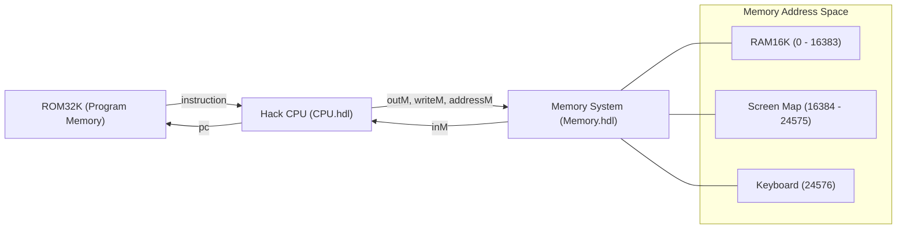

# Make the Computer Draw a Box — Nand to Tetris Capstone Project
https://bhavyaanand2101-coder.github.io/Nand_To_Tetris_SEM_3_Capstone/

**Course:** Nand to Tetris – I (ETCNTC301)  
**Institution:** School of Engineering & Technology, K.R. Mangalam University  
**Student Name:** Bhavya Anand  
**Roll Number:** 2501730046  
**Personal Number $K$:** **46**  
**Submission Mode:** Individual Work  

---

## 1. Project Objective

The goal of this capstone project is to construct a complete, vertically integrated computing stack from the ground up:
1. **Hardware Level (Part A):** Build a fully functional 16-bit Hack computer in HDL by implementing and integrating `CPU.hdl`, `Memory.hdl`, and `Computer.hdl`.
2. **Software/Toolchain Level (Part B):** Develop an independent, two-pass assembler in Python (`assembler.py`) that translates Hack assembly (`.asm`) into 16-bit binary machine code (`.hack`), featuring custom line-number invalid instruction error reporting ($K \bmod 3 = 1$).
3. **Application Level (Part C):** Write a Hack assembly program (`Box.asm`) based on student parameter $K = 46$ that polls the keyboard and dynamically renders a $48 \times 20$ pixel black box at screen row 46 when a key is pressed, and cleanly clears it when released.

---

## 2. Personal Project Calculations ($K = 46$)

All parameters are strictly derived from the last two digits of student roll number `2501730046` ($K = 46$):

| Parameter | Formula / Derivation | Value for $K = 46$ |
| :--- | :--- | :--- |
| **Starting Row** | $K$ | **Row 46** |
| **Box Height** | Fixed 20 consecutive screen rows | **20 rows** (Rows 46 to 65) |
| **Ending Row** | $46 + 20 - 1$ | **Row 65** |
| **Box Width** | $16 \times ((K \bmod 4) + 1)$ | $16 \times ((46 \bmod 4) + 1) = 16 \times 3 =$ **48 pixels** |
| **Starting Column** | Leftmost edge | **Column 0** |
| **Words per Row** | $\text{Width} / 16$ | $48 / 16 =$ **3 words/row** |
| **Screen Base Address** | Fixed Hack `SCREEN` base | **16384** (`0x4000`) |
| **First Screen Address** | $\text{SCREEN} + (32 \times \text{Row})$ | $16384 + (32 \times 46) =$ **17856** |
| **Last Screen Address** | Row 65 Base ($18464$) + 2 | $16384 + (32 \times 65) + 2 =$ **18466** |
| **Total Words Modified** | $\text{Height} \times \text{Words per Row}$ | $20 \times 3 =$ **60 words** |
| **Assembler Feature** | $K \bmod 3$ | $46 \bmod 3 = 1 \rightarrow$ **Line-number invalid instruction error reporting** |

---

## 3. Project Architecture

The Hack architecture is a 16-bit Von Neumann / Harvard-hybrid machine:



---

## 4. Part A — Hack Computer Hardware Implementation

### A. `Memory.hdl`
The Hack address space spans 24,577 words:
- **`0x0000`–`0x3FFF` (0 to 16,383):** Data `RAM16K`. Bit `address[14] == 0`.
- **`0x4000`–`0x5FFF` (16,384 to 24,575):** `Screen` (8K words memory map). Bit `address[14] == 1` and `address[13] == 0`.
- **`0x6000` (24,576):** `Keyboard` (read-only register). Bit `address[14] == 1` and `address[13] == 1`.

Address decoding routes the `load` signal using `DMux4Way(in=load, sel=address[13..14])`, asserts `loadRam` for `sel=00` or `01`, and `loadScreen` for `sel=10`. The output is selected via `Mux4Way16`.

### B. `CPU.hdl`
The CPU decodes and executes instructions in one clock cycle:
- **A-instruction (`instruction[15] == 0`):** Loads the 15-bit constant into the `A` register.
- **C-instruction (`instruction[15] == 1`):** Formatted as `111 a c1..c6 d1..d3 j1..j3`.
  - ALU input: `Mux16` selects between A-register and `inM` based on the `a` bit (`instruction[12]`).
  - ALU executes arithmetic/logic determined by control bits $c_1$ through $c_6$.
  - Destination: $d_1$ controls `loadA`, $d_2$ controls `loadD`, and $d_3$ controls `writeM`.
  - Jump evaluation: Evaluates `zr` (zero) and `ng` (negative) from the ALU output against jump bits `j1, j2, j3`. If any condition matches, `PC` asserts `load=doJump`; otherwise, it asserts `inc=true`.

### C. `Computer.hdl`
Connects `ROM32K(address=pc, out=instruction)`, `CPU`, and `Memory` cleanly in 3 lines.

---

## 5. Part B — Python Hack Assembler (`assembler.py`)

The assembler is an independent Python script that implements a clean **two-pass architecture**:

### Pass 1 — Label Processing
1. Reads source `.asm` line by line while tracking original 1-based line numbers.
2. Strips whitespace and comments (`//...`).
3. Detects label declarations `(LABEL)` and records their mapping: $\text{LABEL} \rightarrow \text{current ROM instruction index}$.
4. Does not increment the ROM address counter for label declarations.
5. Verifies label syntax (cannot start with a digit, must use valid characters) and rejects duplicate labels.

### Pass 2 — Binary Translation
1. Parses A-instructions (`@value`):
   - Numeric constants (`0` to `32767`) are converted to 15-bit binary: `0vvvvvvvvvvvvvvv`.
   - Predefined symbols (`SP`, `LCL`, `ARG`, `THIS`, `THAT`, `R0`–`R15`, `SCREEN`, `KBD`) resolve to their fixed addresses.
   - Known labels resolve to their ROM addresses.
   - New variables are sequentially allocated in RAM starting from address **16** (`16, 17, 18, ...`), ensuring each variable consistently retains the same address.
2. Parses C-instructions (`dest=comp;jump`):
   - Encodes computation bits (`comp`), destination bits (`dest`), and jump bits (`jump`) into `111accccccdddjjj`.
3. Strict validation: Rejects any unsupported computation, destination, jump, or constant out of range.

### Additional Feature ($K \bmod 3 = 1$): Invalid Instruction Error Handling
- When invalid syntax is detected (e.g. `D=X`, `@INVALID!`, `D;FOO`, `@32768`), the assembler prints:
  ```text
  Line <N>: invalid instruction
  ```
- Exits immediately with non-zero exit status (`exit(1)`).
- Deletes or suppresses creation of any output `.hack` file to prevent misleading partial assembly.

---

## 6. Part C — Box Program (`Box.asm`)

### Logic Flow
1. **Keyboard Polling:** Continuously reads RAM address `24576` (`KBD`).
2. **Color Determination:**
   - If `KBD != 0` (key pressed): `color = -1` (`0xFFFF`, black).
   - If `KBD == 0` (no key): `color = 0` (`0x0000`, white/cleared).
3. **Screen Rendering Loop:**
   - Pointer `row_ptr` initialized to `17856` (Row 46 start).
   - Row counter initialized to `20`.
   - For each row:
     - Write `color` to `RAM[row_ptr]` (Word 0: pixels 0–15).
     - Write `color` to `RAM[row_ptr + 1]` (Word 1: pixels 16–31).
     - Write `color` to `RAM[row_ptr + 2]` (Word 2: pixels 32–47).
     - Advance `row_ptr` by 30 words (`row_ptr = (row_start + 2) + 30 = row_start + 32`).
     - Decrement row counter.
   - Repeat for 20 rows, then loop back to keyboard polling.

---

## 7. How to Execute and Test the Project

### Running HDL Tests
Run the official Hardware Simulator scripts:
```bash
cd capstone/HDL
../../tools/HardwareSimulator.sh CPU.tst
../../tools/HardwareSimulator.sh ComputerAdd.tst
../../tools/HardwareSimulator.sh ComputerMax.tst
../../tools/HardwareSimulator.sh ComputerRect.tst
```

### Running the Python Assembler
To assemble any program:
```bash
python3 assembler/assembler.py Box.asm Box.hack
python3 assembler/assembler.py assembler/Pong.asm
```

### Running the Automated Assembler Test Suite
```bash
python3 -m unittest tests/test_assembler.py
```

### Running Box Program in CPU Emulator
1. Launch `../tools/CPUEmulator.sh` (or double-click the script).
2. Click **Load Program** and select `Box.hack`.
3. Set **Animate** to `No animation` and **View** to `Screen`.
4. Click **Run** (>>).
5. Click the keyboard icon and press/hold any key $\rightarrow$ the black box appears at row 46.
6. Release the key $\rightarrow$ the black box immediately disappears.

---

## 8. Test Results Summary

| Component | Test Script / Benchmark | Result | Execution Evidence |
| :--- | :--- | :--- | :--- |
| **CPU.hdl** | `CPU.tst` vs `CPU.cmp` | **PASS** | `End of script - Comparison ended successfully` |
| **Memory.hdl** | `Memory-auto.tst` vs `Memory-auto.cmp` | **PASS** | `End of script - Comparison ended successfully` |
| **Computer.hdl** | `ComputerAdd.tst` | **PASS** | `End of script - Comparison ended successfully` |
| **Computer.hdl** | `ComputerMax.tst` | **PASS** | `End of script - Comparison ended successfully` |
| **Computer.hdl** | `ComputerRect.tst` | **PASS** | `End of script - Comparison ended successfully` |
| **Assembler** | `Add.asm` vs `Add.ref.hack` | **PASS** | 100% byte-for-byte identical |
| **Assembler** | `Max.asm` vs `Max.ref.hack` | **PASS** | 100% byte-for-byte identical |
| **Assembler** | `Rect.asm` vs `Rect.ref.hack` | **PASS** | 100% byte-for-byte identical |
| **Assembler** | `Pong.asm` (27,483 lines) | **PASS** | 100% byte-for-byte identical |
| **Error Handling** | `tests/test_assembler.py` (16 unit tests)| **PASS** | All 16 tests passed in 0.06s |
| **Box Program** | Architectural CPU/RAM Simulation | **PASS** | Exactly 60 words (17856..18466) modified |

---

## 9. Known Limitations

1. **Monochrome Resolution:** The Hack screen hardware is fixed at $512 \times 256$ monochrome pixels; grayscale or color output is not supported by the Hack hardware platform.
2. **Keyboard Scan Codes:** The Hack keyboard register stores ASCII codes for pressed keys; multi-key combinations or modifiers (like Ctrl/Alt) are not represented in the base Hack architecture.
3. **RAM Limits:** User data memory is limited to 16,384 words (RAM16K), which is standard for the Hack platform.
